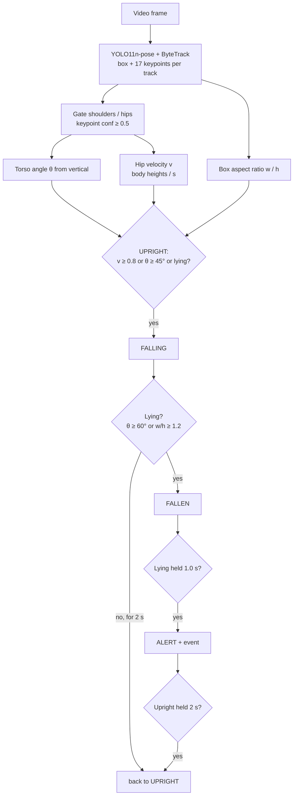

# Fall Detection Alert

Rule-based fall detection on Ultralytics YOLO pose keypoints with multi-person tracking, no training required.

Each tracked person gets a torso angle (shoulder midpoint to hip midpoint, measured from vertical), a box aspect
ratio and a normalized downward hip velocity. A small per-track state machine (`UPRIGHT → FALLING → FALLEN → ALERT`)
turns those features into an alert once a lying posture is held for a configurable time. The output is an annotated
video and, optionally, a JSON list of alert events.


*Demo: two falls from the [fall mix](#fall-mix) (`--imgsz 1280`). Footage: GMDCSA24 (MIT) and, in the full mix,
Pexels (Pexels License); see [samples/README.md](samples/README.md).*

## Features

- YOLO11n-pose (shipped in `weights/`) with ByteTrack or BoT-SORT tracking, CPU-friendly.
- Keypoint-confidence gating; falls back to the box aspect ratio when shoulders/hips are not visible.
- Explainable rules: torso angle, aspect ratio, hip velocity normalized by body height, time thresholds.
- Per-track state machine with recovery (`ALERT` ends after the person is upright for a while).
- Annotated MP4 at the input FPS: box colored by state, `state | angle` label, alert banner with time (pose skeleton optional with `--draw-skeleton`).
- `--events-json` export (track id, fall start, alert start/end, end reason) and `--trace-csv` per-frame features.
- All thresholds in one dataclass and on the CLI; pure logic is standard-library only and unit tested.

## How it works



Formulas, the full state diagram and tuning tips: [docs/how-it-works.md](docs/how-it-works.md).

## Installation

```bash
python -m venv .venv
# Windows: .venv\Scripts\activate    Linux/macOS: source .venv/bin/activate
pip install -r requirements.txt
pip install -e .          # installs the `fall-alert` command
```

The nano pose model runs on CPU (about 5–7 FPS at `imgsz=640` on the laptop CPU used for the results below).
For a GPU, install the PyTorch build matching your CUDA version from [pytorch.org](https://pytorch.org) first.

## Results

### Fall mix

[`results/fall_mix_alert.mp4`](results/fall_mix_alert.mp4) (55.2 s, H.264 720p, no audio) is the annotated output on
[`samples/fall_mix_input.mp4`](samples/README.md#fall-mix-fall_mix_inputmp4): eight GMDCSA24 falls of three subjects
(day and night, side, forward and backward falls) followed by the Pexels snow fall, cut to ~2 s before each
labelled fall and joined without transitions. Default fall thresholds; colors: green `UPRIGHT`, orange `FALLING`, red `FALLEN` / `ALERT`. Hit = `ALERT` starts within the labelled fall window + 2 s.

| Run | Hits | Misses | False alerts | Alert delay after labelled fall start |
|---|---|---|---|---|
| `--imgsz 1280`, `--conf 0.30` (current defaults; published video) | **9 / 9** | 0 | 0 | 1.5–2.6 s; two late hits at +4.0 s (S2 02, S3 04) |
| `--imgsz 1280`, `--conf 0.35` (previous run) | 8 / 9 | 1 (S3 04) | 0 | 1.5–2.6 s, one marginal hit at +4.2 s |
| `--imgsz 640`, `--conf 0.35` (previous run) | 6 / 9 | 3 (S2 02, S3 04, S3 16) | 0 | 1.5–2.4 s |

Own measurement on one compilation, not a validation. Lowering `--conf` to 0.30 kept the person lying on the
patterned floor detected long enough to confirm the two hard segments. In the previous runs the misses came from the pose model losing the person lying
on the floor (each re-detection starts a new track and restarts the 1.0 s confirmation), not from the rules.
Per-segment table, events and observations: [results/README.md](results/README.md#fall-mix).

### Single clips

Outputs produced by this project on two indoor GMDCSA24 clips and one outdoor Pexels snow clip (re-encoded to
H.264 720p, no audio):

| File | Content |
|---|---|
| [`results/gmdcsa24-s1-fall-05_alert.mp4`](results/gmdcsa24-s1-fall-05_alert.mp4) | Walking, then a forward fall to hands and knees and lying on the floor. |
| [`results/gmdcsa24-s1-fall-11_alert.mp4`](results/gmdcsa24-s1-fall-11_alert.mp4) | Standing facing the camera, then a backward fall ending on the side. |
| [`results/snow-pexels-20595440_alert.mp4`](results/snow-pexels-20595440_alert.mp4) | Outdoor: man kicks a tree, falls backward and lies in deep snow (clip ends ~1 s later). |

Measured with the default thresholds (own measurement on 5 clips, not a validation; snow and UniData fall times are
a visual estimate, GMDCSA24 times are dataset labels). The UniData clips are CC BY-NC-ND, so only their numbers
are reported (no annotated video):

| Clip | Fall | `FALLING` | `ALERT` | Upright before? |
|---|---|---|---|---|
| fall-05 | 1.8–5.0 s (label) | 2.27 s | 3.31 s | yes (0–2.24 s) |
| fall-11 | 1.0–6.0 s (label) | 2.03 s | 3.15 s | yes (0–2.00 s) |
| snow-20595440 | ~2.9–3.6 s, ends lying | 3.35 s | none (`FALLEN` at 3.45 s, clip ends 4.55 s) | yes (0–3.30 s) |
| unidata-sample_1 (slip on snow) | ~3.4 s, lies then gets up | 3.47 s | 4.54 s, ends `recovered` at 10.28 s | yes (0–3.4 s) |
| unidata-sample_2 (slip on icy sidewalk, small person) | ~5.5 s, gets up | 5.54 s | 6.66 s with `--imgsz 1280`, ends `recovered` at 12.40 s; **none at the default 640** (person lost by the tracker) | yes |

For small or distant people, run with `--imgsz 1280`.

No false alerts on any clip. The snow clip was detected (`FALLEN`) but ends before the 1.0 s `fallen_seconds`
confirmation (an ID switch at 4.1 s also restarted the timer). Details in
[results/README.md](results/README.md#snow-clips-outdoor-pexels).

Event files, observations and attribution: [results/README.md](results/README.md).

## Usage

```bash
# Default model weights/yolo11n-pose.pt, headless, with event log
fall-alert -i samples/gmdcsa24-s1-fall-05.mp4 -o outputs/fall-05.mp4 --events-json outputs/fall-05.json --no-display

# Longer confirmation time and a stricter lying angle
fall-alert -i input.mp4 -o outputs/out.mp4 --fallen-seconds 3 --lying-angle 70

# Larger official model (auto-downloaded by Ultralytics), BoT-SORT, feature trace for tuning
fall-alert -i input.mp4 -o outputs/out.mp4 --model yolo11s-pose.pt --tracker botsort.yaml --trace-csv outputs/trace.csv

# Module form, without installing (from the repo root)
PYTHONPATH=src python -m fall_alert --help
```

Press `Q` in the preview window to stop early.

### Testing on your own footage

Any local video can be analysed without adding it to the repository: put it in `local_test/` (ignored by git) and run

```bash
fall-alert -i local_test/my_video.mp4 -o local_test/my_video_alert.mp4 --events-json local_test/events.json --imgsz 1280
```

Only publish inputs and outputs you have the right to share (your own recordings with consent, or footage under a
license that allows redistribution). Third-party videos, e.g. YouTube compilations under the standard license, are
fine for private testing but should not be committed.

## Parameters

| Name | Default | Description |
|---|---|---|
| `-i, --input` | — | Input video. |
| `-o, --output` | — | Annotated output MP4 (written at the input FPS, `mp4v`). |
| `--model` | `weights/yolo11n-pose.pt` | Pose weights path or official Ultralytics name (auto-downloaded). |
| `--conf` | `0.30` | Detection confidence threshold. |
| `--imgsz` | `640` | Inference image size. |
| `--tracker` | `bytetrack.yaml` | Ultralytics tracker config (`bytetrack.yaml` or `botsort.yaml`). |
| `--events-json` | — | Write alert events to this JSON file. |
| `--trace-csv` | — | Write per-frame, per-track features and states to this CSV file. |
| `--no-display` | off | Do not open the preview window (implied on Linux without `DISPLAY`/`WAYLAND_DISPLAY`). |
| `--draw-skeleton` | off | Also draw the pose keypoints and skeleton. |
| `--min-kp-conf` | `0.5` | Minimum keypoint confidence for shoulders/hips. |
| `--falling-angle` | `45` | Torso angle from vertical (deg) that starts `FALLING`. |
| `--fall-velocity` | `0.8` | Downward hip velocity (body heights/s) that starts `FALLING`. |
| `--velocity-window` | `0.3` | Time span (s) of the hip velocity estimate. |
| `--height-window` | `2.0` | Time span (s) of the reference body height (max box height). |
| `--lying-angle` | `60` | Torso angle (deg) at or above which the posture is lying. |
| `--lying-aspect` | `1.2` | Box w/h at or above which the posture is lying. |
| `--upright-angle` | `30` | Torso angle (deg) at or below which the posture is upright. |
| `--upright-aspect` | `0.8` | Box w/h at or below which the posture is upright. |
| `--fallen-seconds` | `1.0` | Seconds the lying posture must be held before `ALERT`. |
| `--lying-gap` | `0.3` | Non-lying gaps (s) shorter than this do not interrupt `FALLEN`. |
| `--falling-timeout` | `2.0` | Seconds in `FALLING` without lying before returning to `UPRIGHT`. |
| `--recover-seconds` | `2.0` | Seconds of upright posture that end `ALERT`. |
| `--lost-seconds` | `2.0` | Seconds without detection after which a track is dropped. |
| `--log-level` | `INFO` | Logging verbosity. |

## Output

- **Video** (same resolution and FPS as the input):
  - COCO skeleton per person only with `--draw-skeleton` (off by default);
  - box colored by state: green `UPRIGHT`, orange `FALLING`, red `FALLEN` / `ALERT` (thicker for `ALERT`);
  - label `#<track id> <STATE> | <torso angle> deg` (`n/a` when the torso keypoints are gated out);
    `UPRIGHT` tracks with an `n/a` angle are not drawn, because they are mostly false person detections
    (objects, coats, shadows); falling, fallen and alert tracks are always drawn;
  - red banner `FALL ALERT #<ids> since <t> s` while an alert is open, and the video time in the bottom-right corner.
- **Events JSON** (`--events-json`):

  ```json
  {"input": "clip.mp4",
   "events": [{"track_id": 1, "fall_start": 2.272, "start": 3.312, "end": 5.824, "end_reason": "end_of_video"}]}
  ```

  `fall_start` is the `FALLING` entry time, `start`/`end` bound the `ALERT` state, `end_reason` is `recovered`,
  `lost` or `end_of_video`. Times are seconds of video time.
- **Trace CSV** (`--trace-csv`): `time, track_id, state, torso_angle, aspect_ratio, velocity, box_height`.
- Log lines when an alert starts and a summary of all events at the end.

## Project structure

```
fall-detection-alert/
├── README.md
├── LICENSE
├── pyproject.toml
├── requirements.txt
├── docs/
│   ├── how-it-works.md
│   └── assets/demo.gif
├── results/            # annotated example outputs + event JSON
├── samples/            # GMDCSA24 test clips (MIT), Pexels snow clip, fall mix, UniData samples (CC BY-NC-ND)
├── weights/
│   ├── README.md
│   └── yolo11n-pose.pt
├── src/fall_alert/
│   ├── __init__.py
│   ├── __main__.py
│   ├── cli.py            # argparse entry point
│   ├── config.py         # FallConfig thresholds, RunConfig (stdlib)
│   ├── features.py       # torso angle, aspect ratio, keypoint gating (stdlib)
│   ├── state_machine.py  # per-track UPRIGHT/FALLING/FALLEN/ALERT logic (stdlib)
│   ├── monitor.py        # multi-track manager and alert events (stdlib)
│   ├── pipeline.py       # video loop, tracking, export
│   └── rendering.py      # boxes, labels, banner (optional skeleton)
└── tests/
    ├── test_features.py
    ├── test_monitor.py
    └── test_state_machine.py
```

Run the tests with `pytest`, or without it (standard library only):

```bash
python -c "import sys, importlib; sys.path[:0]=['src','tests']; [f() for m in ('test_features','test_state_machine','test_monitor') for n, f in vars(importlib.import_module(m)).items() if n.startswith('test_')]"
```

## Limitations

- **Research prototype, not a medical or certified safety device.** Do not rely on it to protect people; an alert
  (or its absence) must be checked by a person.
- **Tested on a handful of clips only** (single clips plus one 55 s compilation of nine falls from three
  GMDCSA24 subjects and one snow clip). No recall, false-alarm rate or latency statistics are claimed. Thresholds are generic starting values, not tuned on a dataset.
- **Falls that end sitting are not detected** (torso stays upright, box not wide enough), and very short clips can end
  before the `fallen_seconds` confirmation (the latter happened on the snow clip).
- **Lying on purpose looks like a fall** (bed, sofa, floor exercise) once the posture is held; slow falls and
  sitting down quickly are not distinguished from falls by these rules.
- **View dependence.** A person lying along the camera's line of sight can keep a narrow box and a foreshortened
  torso and may never count as lying. Partial occlusion (furniture) removes keypoints and changes the box.
- **Tracking drives the result.** An ID switch during the fall starts a new track in `UPRIGHT`, which can delay or
  miss the alert. In the fall mix the hard cuts between segments create new tracks as expected, and the previous alert banner
  stays on for up to `lost_seconds` (2 s) after a cut.
- The velocity cue never started `FALLING` on the sample clips: peaks 0.70 and 0.60 H/s (GMDCSA24); on the
  snow kick clip it exceeded 0.8 H/s only after `FALLING` had started. `FALLING` was started by the
  torso angle. See [docs/how-it-works.md](docs/how-it-works.md#5-parameter-guide-and-tuning-tips).
- Timestamps come from the container (`CAP_PROP_POS_MSEC`); the output video is written at a constant FPS, so
  variable-frame-rate inputs can show small timing differences between the banner and the player clock.

## Models & credits

- [Ultralytics YOLO](https://github.com/ultralytics/ultralytics) and the official YOLO11n-pose weights — AGPL-3.0.
- ByteTrack / BoT-SORT trackers as implemented in Ultralytics — AGPL-3.0 (Ultralytics code).
- [OpenCV](https://opencv.org) — Apache-2.0.
- Sample clips from [GMDCSA24](https://github.com/ekramalam/GMDCSA24-A-Dataset-for-Human-Fall-Detection-in-Videos)
  (Ekram Alam et al.) — MIT; see [samples/README.md](samples/README.md) for the citation.
- Snow clip from [Pexels](https://www.pexels.com) (Ovais Ibn farooq) — [Pexels License](https://www.pexels.com/license/);
  see [samples/README.md](samples/README.md#snow-clips-pexels).
- UniData "Fall Detection" samples ([ud-smart-city/fall-detection](https://huggingface.co/datasets/ud-smart-city/fall-detection))
  — CC BY-NC-ND 4.0; used only for the measured times above, see
  [samples/README.md](samples/README.md#unidata-fall-detection-samples-cc-by-nc-nd-40).

See [weights/README.md](weights/README.md) for model files and sizes.

## License

AGPL-3.0, because the project depends on Ultralytics YOLO (AGPL-3.0). See the `LICENSE` file.
The sample clips keep their own licenses (GMDCSA24: MIT; snow clip: Pexels License; UniData samples: CC BY-NC-ND 4.0,
redistributed unmodified and not used in any derivative; see [samples/README.md](samples/README.md)).
