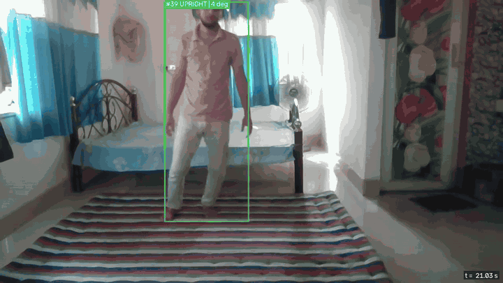
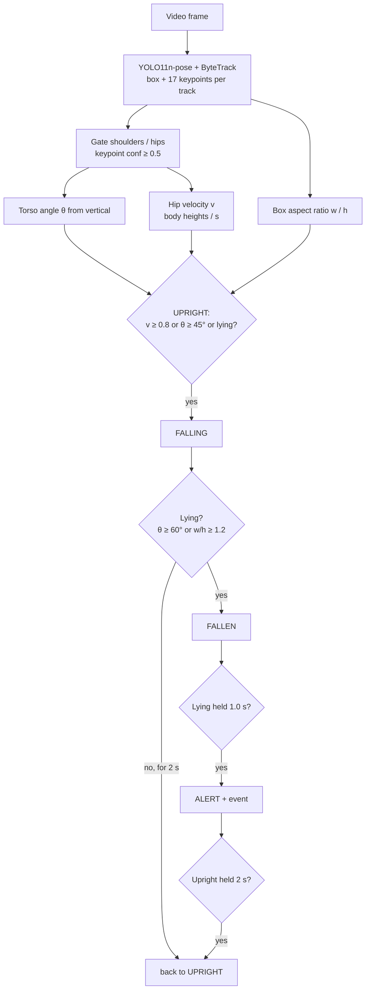

# Fall Detection Alert

Rule-based fall detection on Ultralytics YOLO pose keypoints with multi-person tracking, no training required.

Each tracked person gets a torso angle (shoulder midpoint to hip midpoint, measured from vertical), a box aspect
ratio and a normalized downward hip velocity. A small per-track state machine (`UPRIGHT → FALLING → FALLEN → ALERT`)
turns those features into an alert once a lying posture is held for a configurable time. The output is an annotated
video and, optionally, a JSON list of alert events.


<!-- add a short demo GIF here -->

## Features

- YOLO11n-pose (shipped in `weights/`) with ByteTrack or BoT-SORT tracking, CPU-friendly.
- Keypoint-confidence gating; falls back to the box aspect ratio when shoulders/hips are not visible.
- Explainable rules: torso angle, aspect ratio, hip velocity normalized by body height, time thresholds.
- Per-track state machine with recovery (`ALERT` ends after the person is upright for a while).
- Annotated MP4 at the input FPS: skeleton, box colored by state, `state | angle` label, alert banner with time.
- `--events-json` export (track id, fall start, alert start/end, end reason) and `--trace-csv` per-frame features.
- All thresholds in one dataclass and on the CLI; pure logic is standard-library only and unit tested.

## How it works



Formulas, the full state diagram and tuning tips: [docs/how-it-works.md](docs/how-it-works.md).

## Installation

```bash
python -m venv .venv
# Windows: .venv\Scripts\activate    Linux/macOS: source .venv/bin/activate
pip install -r requirements.txt
pip install -e .          # installs the `fall-alert` command
```

The nano pose model runs on CPU (about 5–7 FPS at `imgsz=640` on the laptop CPU used for the results below).
For a GPU, install the PyTorch build matching your CUDA version from [pytorch.org](https://pytorch.org) first.

## Results

Outputs produced by this project on two GMDCSA24 clips (re-encoded to H.264 720p, no audio):

| File | Content |
|---|---|
| [`results/gmdcsa24-s1-fall-05_alert.mp4`](results/gmdcsa24-s1-fall-05_alert.mp4) | Walking, then a forward fall to hands and knees and lying on the floor. |
| [`results/gmdcsa24-s1-fall-11_alert.mp4`](results/gmdcsa24-s1-fall-11_alert.mp4) | Standing facing the camera, then a backward fall ending on the side. |

Measured with the default thresholds (own measurement on 2 clips, not a validation):

| Clip | Labelled fall | `FALLING` | `ALERT` | Upright before? |
|---|---|---|---|---|
| fall-05 | 1.8–5.0 s | 2.27 s | 3.31 s | yes (0–2.24 s) |
| fall-11 | 1.0–6.0 s | 2.03 s | 3.15 s | yes (0–2.00 s) |

Event files, observations and attribution: [results/README.md](results/README.md).

## Usage

```bash
# Default model weights/yolo11n-pose.pt, headless, with event log
fall-alert -i samples/gmdcsa24-s1-fall-05.mp4 -o outputs/fall-05.mp4 --events-json outputs/fall-05.json --no-display

# Longer confirmation time and a stricter lying angle
fall-alert -i input.mp4 -o outputs/out.mp4 --fallen-seconds 3 --lying-angle 70

# Larger official model (auto-downloaded by Ultralytics), BoT-SORT, feature trace for tuning
fall-alert -i input.mp4 -o outputs/out.mp4 --model yolo11s-pose.pt --tracker botsort.yaml --trace-csv outputs/trace.csv

# Module form, without installing (from the repo root)
PYTHONPATH=src python -m fall_alert --help
```

Press `Q` in the preview window to stop early.

## Parameters

| Name | Default | Description |
|---|---|---|
| `-i, --input` | — | Input video. |
| `-o, --output` | — | Annotated output MP4 (written at the input FPS, `mp4v`). |
| `--model` | `weights/yolo11n-pose.pt` | Pose weights path or official Ultralytics name (auto-downloaded). |
| `--conf` | `0.35` | Detection confidence threshold. |
| `--imgsz` | `640` | Inference image size. |
| `--tracker` | `bytetrack.yaml` | Ultralytics tracker config (`bytetrack.yaml` or `botsort.yaml`). |
| `--events-json` | — | Write alert events to this JSON file. |
| `--trace-csv` | — | Write per-frame, per-track features and states to this CSV file. |
| `--no-display` | off | Do not open the preview window (implied on Linux without `DISPLAY`/`WAYLAND_DISPLAY`). |
| `--min-kp-conf` | `0.5` | Minimum keypoint confidence for shoulders/hips. |
| `--falling-angle` | `45` | Torso angle from vertical (deg) that starts `FALLING`. |
| `--fall-velocity` | `0.8` | Downward hip velocity (body heights/s) that starts `FALLING`. |
| `--velocity-window` | `0.3` | Time span (s) of the hip velocity estimate. |
| `--height-window` | `2.0` | Time span (s) of the reference body height (max box height). |
| `--lying-angle` | `60` | Torso angle (deg) at or above which the posture is lying. |
| `--lying-aspect` | `1.2` | Box w/h at or above which the posture is lying. |
| `--upright-angle` | `30` | Torso angle (deg) at or below which the posture is upright. |
| `--upright-aspect` | `0.8` | Box w/h at or below which the posture is upright. |
| `--fallen-seconds` | `1.0` | Seconds the lying posture must be held before `ALERT`. |
| `--lying-gap` | `0.3` | Non-lying gaps (s) shorter than this do not interrupt `FALLEN`. |
| `--falling-timeout` | `2.0` | Seconds in `FALLING` without lying before returning to `UPRIGHT`. |
| `--recover-seconds` | `2.0` | Seconds of upright posture that end `ALERT`. |
| `--lost-seconds` | `2.0` | Seconds without detection after which a track is dropped. |
| `--log-level` | `INFO` | Logging verbosity. |

## Output

- **Video** (same resolution and FPS as the input):
  - COCO skeleton per person;
  - box colored by state: green `UPRIGHT`, orange `FALLING`, red `FALLEN` / `ALERT` (thicker for `ALERT`);
  - label `#<track id> <STATE> | <torso angle> deg` (`n/a` when the torso keypoints are gated out);
  - red banner `FALL ALERT #<ids> since <t> s` while an alert is open, and the video time in the bottom-right corner.
- **Events JSON** (`--events-json`):

  ```json
  {"input": "clip.mp4",
   "events": [{"track_id": 1, "fall_start": 2.272, "start": 3.312, "end": 5.824, "end_reason": "end_of_video"}]}
  ```

  `fall_start` is the `FALLING` entry time, `start`/`end` bound the `ALERT` state, `end_reason` is `recovered`,
  `lost` or `end_of_video`. Times are seconds of video time.
- **Trace CSV** (`--trace-csv`): `time, track_id, state, torso_angle, aspect_ratio, velocity, box_height`.
- Log lines when an alert starts and a summary of all events at the end.

## Project structure

```
fall-detection-alert/
├── README.md
├── LICENSE
├── pyproject.toml
├── requirements.txt
├── docs/
│   ├── how-it-works.md
│   └── assets/demo.gif
├── results/            # annotated example outputs + event JSON
├── samples/            # two GMDCSA24 test clips (MIT)
├── weights/
│   ├── README.md
│   └── yolo11n-pose.pt
├── src/fall_alert/
│   ├── __init__.py
│   ├── __main__.py
│   ├── cli.py            # argparse entry point
│   ├── config.py         # FallConfig thresholds, RunConfig (stdlib)
│   ├── features.py       # torso angle, aspect ratio, keypoint gating (stdlib)
│   ├── state_machine.py  # per-track UPRIGHT/FALLING/FALLEN/ALERT logic (stdlib)
│   ├── monitor.py        # multi-track manager and alert events (stdlib)
│   ├── pipeline.py       # video loop, tracking, export
│   └── rendering.py      # skeleton, boxes, labels, banner
└── tests/
    ├── test_features.py
    ├── test_monitor.py
    └── test_state_machine.py
```

Run the tests with `pytest`, or without it (standard library only):

```bash
python -c "import sys; sys.path[:0]=['src','tests']; import test_state_machine as t; [f() for n, f in vars(t).items() if n.startswith('test_')]"
```

## Limitations

- **Research prototype, not a medical or certified safety device.** Do not rely on it to protect people; an alert
  (or its absence) must be checked by a person.
- **Tested on two clips only**, of one subject in one room with a fixed camera. No recall, false-alarm rate or
  latency statistics are claimed. Thresholds are generic starting values, not tuned on a dataset.
- **Lying on purpose looks like a fall** (bed, sofa, floor exercise) once the posture is held; slow falls and
  sitting down quickly are not distinguished from falls by these rules.
- **View dependence.** A person lying along the camera's line of sight can keep a narrow box and a foreshortened
  torso and may never count as lying. Partial occlusion (furniture) removes keypoints and changes the box.
- **Tracking drives the result.** An ID switch during the fall starts a new track in `UPRIGHT`, which can delay or
  miss the alert. On the 12 s concatenated test video the cut between clips created a new track as expected.
- The velocity cue did not cross its 0.8 H/s default on the sample clips (peaks 0.70 and 0.60 H/s); `FALLING` was
  started by the torso angle. See [docs/how-it-works.md](docs/how-it-works.md#5-parameter-guide-and-tuning-tips).
- Timestamps come from the container (`CAP_PROP_POS_MSEC`); the output video is written at a constant FPS, so
  variable-frame-rate inputs can show small timing differences between the banner and the player clock.

## Models & credits

- [Ultralytics YOLO](https://github.com/ultralytics/ultralytics) and the official YOLO11n-pose weights — AGPL-3.0.
- ByteTrack / BoT-SORT trackers as implemented in Ultralytics — AGPL-3.0 (Ultralytics code).
- [OpenCV](https://opencv.org) — Apache-2.0.
- Sample clips from [GMDCSA24](https://github.com/ekramalam/GMDCSA24-A-Dataset-for-Human-Fall-Detection-in-Videos)
  (Ekram Alam et al.) — MIT; see [samples/README.md](samples/README.md) for the citation.

See [weights/README.md](weights/README.md) for model files and sizes.

## License

AGPL-3.0, because the project depends on Ultralytics YOLO (AGPL-3.0). See the `LICENSE` file.
The sample clips keep their own MIT license (see [samples/README.md](samples/README.md)).
