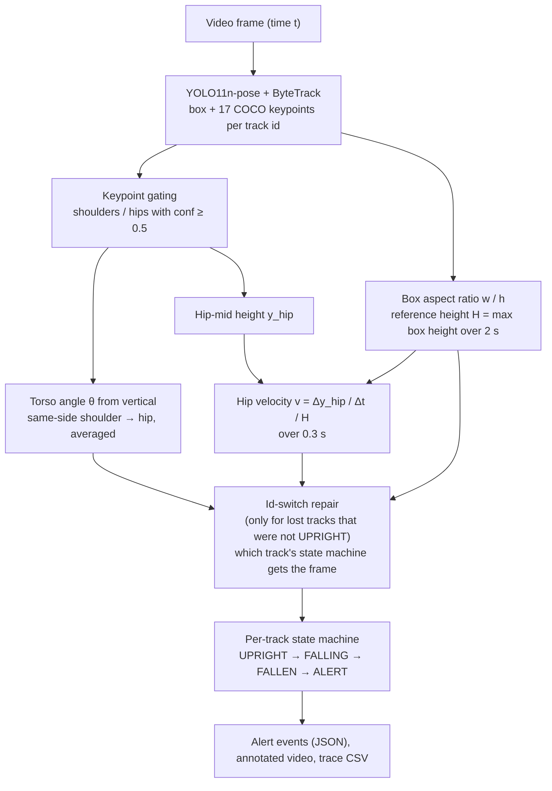
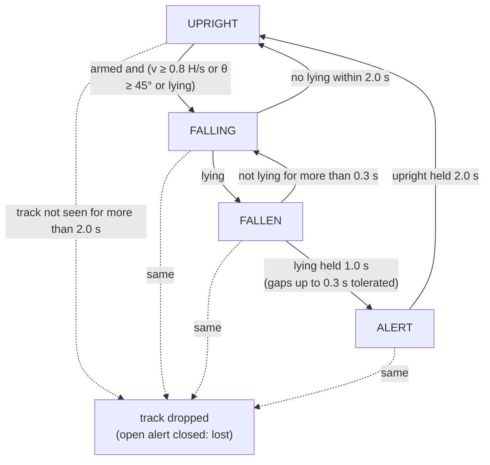

# How it works

The pipeline runs an Ultralytics YOLO pose model with tracking on every frame,
computes a few posture and motion features per tracked person, and feeds them to
a small per-track state machine. No model is trained; every alert can be
explained from the logged features (`--trace-csv`).



## 1. Detection, keypoints and tracking

`model.track(frame, persist=True, classes=[0], conf=0.30, imgsz=640, tracker="bytetrack.yaml")`
returns, for each person with a confirmed track id, a box `(x1, y1, x2, y2)` and
17 COCO keypoints `(x, y, confidence)`. Detections without a track id are ignored.
For small or distant people use `--imgsz 1280` (the published fall mix was run this way).

**Rendering.** Boxes are colored by state: green `UPRIGHT`, orange `FALLING`, red `FALLEN` / `ALERT`.
Upright tracks whose torso angle is `n/a` (shoulder/hip keypoints below `min_kp_conf`) are not drawn,
because they are mostly false person detections; falling, fallen and alert tracks are always drawn.
The pose skeleton is drawn only with `--draw-skeleton`.

## 2. Features (`features.py`, standard library only)

**Keypoint gating.** A shoulder or hip is used only if its confidence is at least
`min_kp_conf` (0.5). The hip midpoint `P` (mean of the visible hips, one is enough) gives the hip height used
for velocity. The torso angle uses same-side pairs only: left shoulder with left hip, right shoulder with right hip.

**Torso angle** from the downward vertical (image y grows downward):

```
θ_side = atan2(|hip.x − shoulder.x|, hip.y − shoulder.y)        in degrees, 0..180
θ = mean of θ_left and θ_right (those whose two points pass the gate)
```

0° is upright, 90° horizontal, values above 90° mean the hips are above the
shoulders (e.g. lying with the head lower than the hips). If neither side has both its
shoulder and its hip above the gate, `θ` is undefined and only the aspect ratio is used. A
shoulder and a hip of opposite sides are deliberately not paired: on a turned or lying
body the diagonal includes the body width (about 35° for an upright person) and skews
the angle.

**Aspect ratio** `r = (x2 − x1) / (y2 − y1)` of the person box.

**Reference height** `H` = maximum box height of the track over the last
`height_window` (2 s). During a fall the box shrinks; `H` keeps the standing height.

**Normalized vertical velocity** of the hip midpoint over the last
`velocity_window` (0.3 s), positive downward:

```
v = (y_hip(t) − y_hip(t − Δt)) / Δt / H        [body heights per second]
```

It uses the oldest and the newest hip sample inside the window (no smoothing) and is computed only when they span
at least half the window; frames where the hips are gated out are skipped. With less than about 3.4 frames per second
the window holds a single sample and `v` is never available. Time comes from the frame timestamps, not from a frame
count, so a variable frame rate does not change the units.

## 3. Posture classes

```
lying   = (θ defined and θ ≥ lying_angle=60°)  or  r ≥ lying_aspect=1.2
upright = (θ undefined or θ ≤ upright_angle=30°)  and  r ≤ upright_aspect=0.8
```

A pose can be neither (e.g. bending over, sitting).

## 4. State machine (`state_machine.py`, standard library only)



`ALERT` is left only through the upright timer: a person who sits up (neither lying nor upright) keeps the alert open.

- `fall_start` is the time of the first entry into `FALLING` of the fall episode and is
  reported with the alert. It is set on `UPRIGHT → FALLING` and kept on `FALLEN → FALLING`
  (a person who shifts on the floor and drops out of lying keeps the original onset);
  a new value is only set after the track went back to `UPRIGHT`. The `falling_timeout`
  still counts from the latest entry into `FALLING`.
- A track leaves `UPRIGHT` only once it is *armed*: one frame with at least
  `min_pose_keypoints` (6) keypoints above `min_kp_conf`. Objects detected as a
  person (bins, coats, shadows) rarely show a body pose, so they never fall.
- Id-switch repair: when a new track id appears within `stitch_distance` (1.0 body
  heights) of a track lost less than `lost_seconds` ago, it takes over that track's
  state machine and open alert. Only tracks that were `FALLING`, `FALLEN` or `ALERT`
  when last seen are candidates: during a fall the box goes from tall to wide and
  trackers often start a new id, and without the repair the 1.0 s confirmation would
  restart. A track lost while `UPRIGHT` is never stitched, so a new person walking in
  near it starts a new state machine in `UPRIGHT` (unarmed until one frame with enough
  keypoints). The stitched track keeps the old machine as is (including `armed`), and
  the open alert moves with it, still one event. If the newcomer is upright, the
  inherited `ALERT` ends as `recovered` once it has been upright for `recover_seconds`;
  if nothing stitches, the alert closes as `lost` at the last time the old track was seen.
  Results published before this rule was added were produced with the older, broader
  stitching and may differ.
- A single frame can pass several transitions: a lying posture seen in `UPRIGHT`
  goes straight to `FALLEN` (via `FALLING`).
- The upright timer for recovery counts consecutive upright frames; any
  non-upright frame restarts it.
- All timers run on video time, also across detection gaps shorter than `lost_seconds`: a person who is
  lying when the track disappears and reappears lying 1.5 s later goes to `ALERT` on the first frame after the gap.
- A track that is not detected for more than `lost_seconds` (2 s) is dropped; an
  open alert is closed with the time it was last seen (`end_reason: "lost"`). A
  track that reappears later with the same id starts again in `UPRIGHT`. The alert
  banner only lists tracks seen within the last `lying_gap` seconds, so it clears as
  soon as the person leaves the screen.
- At the end of the video, open alerts are closed with `end_reason: "end_of_video"`.
- Timestamps are video time from `CAP_PROP_POS_MSEC` (falls back to
  `frame_index / fps`, with 30 FPS if the container reports none), so the logic
  does not depend on processing speed. Time never goes backwards: a timestamp earlier
  than the previous frame's is held at the previous value.

## 5. Parameter guide and tuning tips

| Parameter | Default | Effect of increasing it |
|---|---|---|
| `min_kp_conf` | 0.5 | Fewer, more reliable keypoints; more frames fall back to the aspect ratio only. |
| `falling_angle` | 45° | `FALLING` starts later in the fall; fewer `FALLING` episodes from bending. |
| `fall_velocity` | 0.8 H/s | The velocity cue fires only on faster drops. |
| `velocity_window` | 0.3 s | Smoother but more delayed velocity. |
| `height_window` | 2.0 s | Reference height remembers the standing height for longer. |
| `lying_angle` | 60° | Requires a more horizontal torso to count as lying. |
| `lying_aspect` | 1.2 | Requires a wider box to count as lying (by box alone). |
| `upright_angle` / `upright_aspect` | 30° / 0.8 | Recovery is accepted from less straight postures. |
| `fallen_seconds` | 1.0 s | Later alerts, fewer alerts from brief lying-like poses. |
| `lying_gap` | 0.3 s | More tolerance to keypoint glitches while on the floor. |
| `falling_timeout` | 2.0 s | Longer wait for a lying posture after a suspicious motion. |
| `recover_seconds` | 2.0 s | The person must stand longer before the alert ends. |
| `lost_seconds` | 2.0 s | Tracks survive longer occlusions. |
| `min_pose_keypoints` | 6 | Stricter filter against objects detected as a person; a person seen only partly may never be armed. |
| `stitch_distance` | 1.0 body heights | Repairs id switches further away, with more risk of merging two nearby people (only tracks lost while not `UPRIGHT` are candidates). |

Tips:

- Run with `--trace-csv trace.csv` and plot `torso_angle`, `aspect_ratio` and
  `velocity` per track to see how far your footage is from each threshold.
- On the two GMDCSA24 single clips the hip velocity peaked at 0.70 and 0.60 H/s (see
  [results/README.md](../results/README.md)), below the 0.8 default, so `FALLING`
  was started by the torso angle. Lowering `fall_velocity` (e.g. 0.5) makes
  `FALLING` start earlier but also reacts to sitting down quickly; it does not
  change when `ALERT` fires, which depends on the lying posture.
- The aspect-ratio rule depends on the camera view: a person lying along the
  camera's optical axis can have a narrow box and a foreshortened torso, so the
  posture may never count as lying. High-mounted cameras help.
- A person cut by the image border has a clipped box (different aspect ratio and reference height) and
  often no hip or shoulder keypoints; the rules then rely on the aspect ratio alone.
- If only one shoulder and one hip on opposite sides pass the gate, the angle includes the body width
  (about 35° for an upright person): such a frame is neither upright nor lying by the angle.
- For lying-down on purpose (bed, sofa, exercise), the rules alone cannot tell the
  difference; restrict the zone or add a second-stage classifier.
